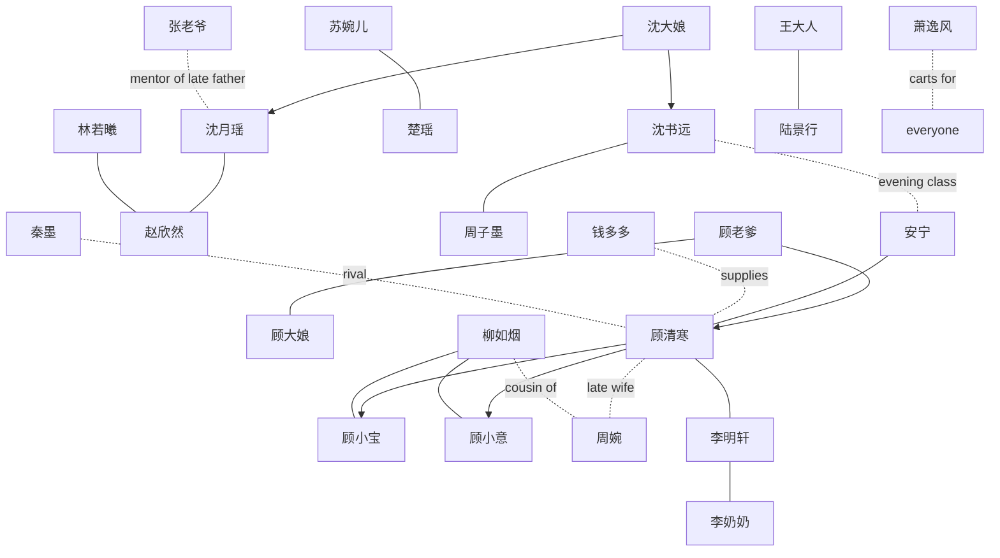

# 锦绣人生 (Jǐnxiù Rénshēng) - Series bible (stage 1, awaiting approval)

Tagline: 一千个普通人的故事 - "Một nghìn câu chuyện về những con người bình thường."
Audience: Vietnamese learners of Mandarin. Teaching language of the review: Vietnamese.
Format: 1,000 episodes, 10 seasons x 100, ~45 min. Slice-of-life; romance ~10 %.

## 1. Series concept

A year-by-year portrait of one lane in a river city: a restaurant that nearly closes, a medicine shop,
a clothing shop, a school, a market. Families argue and carry each other. Money is tight, festivals
are bright, small kindnesses change lives. Laughter first, tears sometimes, lessons never lectured.

Engine of every episode: one ordinary situation (cooking, shopping, an illness, a fee, a festival) +
one human experience + a thread that continues + 10-15 usable Mandarin words.

Promise to the viewer: you will learn to order food, bargain, thank, apologise, comfort, ask for help,
talk about family and money - by living with these people.

## 2. Fictional dynasty and world

- **大昭朝 Dà Zhāo Cháo** (invented). Reign year 昭安 (Zhāo'ān) 十二年 at the start. Peaceful, trade-rich;
  the emperor and court are distant background (a name on a notice board, a tax, a festival decree).
  No real historical figures or events.
- **青梧城 Qīngwú Chéng**, river city on the 澜水 (Lán Shuǐ). Wutong (梧桐) trees line the streets; the
  city bell tower 观澜楼 rings the hours.
- **长乐巷 Chánglè Xiàng** - the lane where most of the cast live and work. Shop signs, a stone bridge
  (回望桥), a well, a noodle stall, a teahouse corner.
- Places: 归味楼 (Guī Wèi Lóu) Gu family restaurant · 回春堂 (Huí Chūn Táng) medicine shop ·
  锦绣坊 (Jǐnxiù Fāng) clothing shop · 听雨轩 (Tīng Yǔ Xuān) teahouse · 青梧书院 academy ·
  金玉楼 (Jīnyù Lóu) the rival big restaurant · 钱氏粮行 grain shop · 萧记车行 cart yard · 衙门
  (magistrate's office) · 东市 / 西市 markets · 慈云寺 temple on the hill · 澜水码头 docks · 皇城 far
  up-river (days away).
- Money: 文 (copper coin), 两 (silver tael), 贯. 1 碗面 = 12 文; a day laborer earns ~40 文; a good
  coat = 2 两. Keep prices consistent (see ledger).
- Calendar: lunar. Season 1 runs from 昭安十二年 late 八月 (early autumn) to the next Mid-Autumn.
- Festivals used: 重阳, 冬至, 腊八, 小年, 除夕/春节, 元宵, 清明, 端午, 七夕, 中秋.
- Tone rules: gentle humour, real money worries, nobody is a cartoon, no magic, no secret-heir plots.

## 3. Characters (23) - all fictional, faces AI-generated and locked in character-bank

Source: reference sheet of 20 portraits + 3 added parents (顾老爹, 顾大娘, 沈大娘) because parents are the
heart of the series. Ages at Season 1 start. Colours from the sheet stay fixed.

### 顾家 Gù family (归味楼)
**顾清寒 Gù Qīnghán, 33 - restaurant owner, widower, father (男主)**
- Face: lean, strong brows, deep-set serious eyes, small scar through left eyebrow; long black hair,
  high topknot with a plain dark wood pin. Costume: black robe with gold-thread embroidery (festival);
  dark grey apron-robe at work.
- Personality: dutiful, proud, hides worry behind a stern face. Strength: patient cook, reliable.
  Flaw: never asks for help; shows love as silence. Fear: failing his father and his kids. Ambition:
  to make 归味楼 a place people come home to, not just eat at.
- Speech: short sentences, "嗯", "没事", "我来". Says sorry by fixing things.
- Secret: knows his late wife 周婉's illness cost more than his father admitted; learns the full debt
  in S1.
- Care beats: remembers that 月瑶 hates cilantro; packs extra for whoever is late.
**顾老爹 Gù Lǎodiē, 63 - his father, founder** (added)
- Stout, white at the temples, thick hands; blue-grey cotton robe, cloth cap. Strict, stubborn,
  proud of "my recipe"; jokes badly; cannot say "I'm worried". Secret: borrowed a large sum from 秦墨's
  uncle to pay 周婉's doctors and never told 清寒. Arc: lets his son lead; passes the 汤 recipe.
**顾大娘 Gù Dàniáng, 60 - his mother** (added)
- Small, quick, brown-patterned jacket; hums while cooking; hides her aching knees; worries about
  everyone's meals. Peacemaker with a sharp tongue when pushed.
**顾小宝 Gù Xiǎobǎo, 8 - son.** Cheerful, curious, short hair, blue robe; hides bad marks; wants to be
  "a cook like Papa" and later a teacher. Asks the questions adults avoid.
**顾小意 Gù Xiǎoyì, 6 - daughter.** Pink hanfu, hair buns with flower pins; quiet, observant, stops
  eating when sad; draws everything. Keeps a small cloth rabbit made by her late mother.

### 沈家 Shěn family (回春堂 / 青梧书院)
**沈月瑶 Shěn Yuèyáo, 28 - runs 回春堂 medicine shop (女主).** Pink floral hanfu (work: pale pink
  apron-sleeves); warm eyes, small dimple on the right cheek; hair half-up with flowers. Capable,
  funny, direct; works too long. Flaw: puts everyone's health before her own; hates being told whom to
  marry. Ambition: take 回春堂 beyond the lane (a free clinic day). Speech: lively, teasing, "别担心",
  "听我的". Care beat: leaves herbal tea at the door of whoever is tired.
**沈书远 Shěn Shūyuǎn, 35 - her older brother, teacher at 青梧书院.** White robe, round glasses, always
  holding a book; kind, absent-minded, bad with money; gentle jokes. Teaches evening classes for the
  poor. Wants a proper school building.
**沈大娘 Shěn Dàniáng, 58 - their mother, widow** (added). Plum-coloured jacket; talkative,
  matchmaking, afraid of being alone; fiercely proud of her children. Arc: learns to respect月瑶's
  choices.
**张老爷 Zhāng Lǎoye, 78 - retired doctor** who trained 月瑶's late father; lives in the back room of
  回春堂. Long white hair and beard, grey robe, carved cane. Wise, stubborn, sneaks sweets. Slowly
  begins to forget (S1 on); his memory arc ties to a hidden letter (S1 finale).

### 街坊 The lane
**李明轩 Lǐ Míngxuān, 29 - 顾清寒's best friend, delivery runner / aspiring noodle-shop owner.**
  Brown robe, laughs loudly, tousled hair. Funny, loyal, impatient. Arc: learns patience, opens his
  noodle stall. Grandson of 李奶奶.
**李奶奶 Lǐ Nǎinai, 72 - dumpling-stall owner.** Silver bun, purple robe; feeds everyone; remembers
  everyone's birthday; secretly lonely when 明轩 is out. Opinions on everything.
**赵欣然 Zhào Xīnrán, 27 - owns 点心铺 (pastry shop), 月瑶's best friend.** Cream-yellow hanfu; big
  smile, gossip, good heart; learns that gossip wounds. Wants a bigger shop.
**苏婉儿 Sū Wǎn'ér, 26 - owner of 锦绣坊 clothing shop.** Light blue hanfu; sunny, quick with figures,
  hates waste; parents far away; sends them money and letters. Loves bargaining games.
**楚瑶 Chǔ Yáo, 24 - head seamstress at 锦绣坊, newcomer.** Red patterned hanfu, red hair ornaments;
  fiery, independent, left a village to escape an arranged marriage; saves to open her own workshop.
**林若曦 Lín Ruòxī, 25 - owner of 听雨轩 teahouse.** Lilac hanfu, purple hair flowers; shy, artistic,
  daughter of a rich tea merchant who wants a match for her; she wants her own path.
**钱多多 Qián Duōduo, 40 - grain and dry-goods merchant (钱氏粮行).** Tan-brown robe; round cheerful
  face; loves money and jokes, secretly generous; will lose money rather than cheat. Comic anchor.
**安宁 Ān Níng, 22 - market vegetable seller, then 归味楼 helper.** Pale mint hanfu; plain ornaments;
  orphan raised by the temple; hard-working, learning to read at evening class; big laugh, bigger
  appetite.
**柳如烟 Liǔ Rúyān, 29 - embroidery and calligraphy teacher; 周婉's younger cousin.** Green hanfu,
  elegant; quiet; helps raise 小宝 and 小意 as their "aunt"; slow, mature friendship with 书远.
**周子墨 Zhōu Zǐmò, 27 - poor scholar preparing for the exam.** Navy robe, topknot; lodges at the
  academy, works nights at an inn; proud, hungry, brilliant; learns to accept help.
**萧逸风 Xiāo Yìfēng, 31 - runs 萧记车行 (carts and carriers), ex-guard.** Dark green robe, long hair
  tied low; calm, few words; quietly helps everyone; cares for his deaf younger sister 萧小雨 (minor).
**陆景行 Lù Jǐngxíng, 30 - clerk at the magistrate's office.** White-pale blue robe, silver hair
  crown; honest, neat, worries; wants to be a fair magistrate. Not a love rival: friend to all.

### Officials and rival
**王大人 Wáng Dàrén, 52 - magistrate of 青梧城.** Navy robe, goatee, official's hat; strict, fair,
  lonely (children away in the capital); eats alone; softens through the lane's invitations.
**秦墨 Qín Mò, 41 - owner of 金玉楼, rival restaurateur.** Black-gold embroidered robe, immaculate;
  grew up hungry, built his empire on never being poor again; undercuts prices, but keeps a
  childhood habit of saving the last rice grains. Not evil: a man afraid of losing. Arc: from rival to
  reluctant ally (S5), full humanising reveal (S9).

## 4. Relationship maps

Slow bonds (none rushed, none promised):
- 顾清寒 - 沈月瑶: neighbours, her treating his kids, trust; first real hand-hold not before ~S3.
- 沈书远 - 柳如烟: two quiet readers; a long letter-writing friendship; marriage possible late.
- 李明轩 - 赵欣然: teasing friends; maybe.
- 苏婉儿 - 楚瑶: business partners and sisters-in-spirit.
- 林若曦: chooses her path; romance optional.
- 周子墨, 陆景行, 萧逸风, 安宁, 钱多多, 王大人, 秦墨: no romance needed; full lives.

Family trees:
- 顾: 顾老爹 + 顾大娘 -> 顾清寒 (+ late wife 周婉) -> 小宝, 小意. 柳如烟 is 周婉's cousin.
- 沈: late 沈先生 + 沈大娘 -> 沈书远, 沈月瑶. (沈先生 was 张老爷's apprentice.)
- 李: 李奶奶 -> (son away) -> 李明轩.
- 萧: 萧逸风 + younger sister 萧小雨.

## 5. Major secrets and threads (Season 1 core)

1. 顾老爹's hidden debt (borrowed for 周婉's care from 秦墨's uncle's loan house) - revealed ep2 (a
   note), details ep92, cleared ep98 by the lane's community, not by a windfall.
2. 张老爷's memory slipping and the sealed letter from the capital (ep30 hint, ep100 hook): a former
   patient in the capital asks for him.
3. 秦墨's price war against 归味楼: motive revealed slowly (he once begged outside 归味楼's kitchen
   door as a boy and was turned away - or was he?).
4. 周婉's death and the kids' grief; the cloth rabbit.
5. 安宁's reading: from signing with a thumbprint to reading a letter aloud (ep87).
6. 林若曦's decision: not to marry the match; to expand the teahouse into a reading room.

## 6. Ten-season storyline (100 episodes each)

| S | Title | Time | Major storyline | Season-end payoff / hook |
|---|---|---|---|---|
| 1 | 归味 Guī Wèi - Taste of home | autumn y12 -> Mid-Autumn y13 | 归味楼 survives a debt and a price war; lane learns to carry each other; 老爹 and 清寒 reconcile | Debt cleared by the lane; sealed capital letter for 张老爷 |
| 2 | 回春 Huí Chūn - Spring returns | y13 autumn -> y14 | 张老爷's illness; 月瑶's free clinic; capital letter -> trip; parents and ageing | 张老爷 chooses to spend his last clear years at home; clinic opens |
| 3 | 锦绣 Jǐnxiù - Brocade | y14 | 锦绣坊 and women's work: 楚瑶 + 苏婉儿 + 林若曦 co-op; independence vs family expectation | The co-op wins a town order; 若曦 and father truce |
| 4 | 书声 Shū Shēng - Voices of learning | y15 | 书院 building fund; 周子墨's exam; 安宁's schooling; 小宝 starts to read | Exam results; school roof raised |
| 5 | 粮 Liáng - Grain | y16 | Bad harvest; 钱多多's honesty test; 秦墨 becomes ally | Grain shared; 秦墨 and 清寒 share a table |
| 6 | 远路 Yuǎn Lù - Long road | y17 | 萧逸风's convoy to the capital; letters; separations; a sibling leaves to study | Return; lane welcomes travellers |
| 7 | 澜水 Lán Shuǐ - River flood | y18 | Flood and rebuilding; 王大人's loneliness; community | New bridge; 王大人 joins the lane's table |
| 8 | 长大 Zhǎng Dà - Growing up | y19-22 (time skip) | 小宝 and 小意 grow; parents age; first romance for the next generation | 小宝's first meal as cook |
| 9 | 旧账 Jiù Zhàng - Old accounts | y23 | Old secrets: 老爹's loan, 秦墨's past, 王大人's lost son; forgiveness | All accounts closed |
| 10 | 灯火 Dēnghuǒ - Lantern lights | y24-25 | 十周年 festival; everyone's life milestones; legacy | Final lantern night, the lane lit |

Each season repeats the yearly festival cycle but never the same stories; each mid-season (episode
50) has a family-centred festival beat, each finale (episode 100) a community gathering.

## 7. Content mix guard (target over 1,000 episodes)
30 % family (F) · 25 % everyday life/work/business (E) · 20 % friendship/community (C) · 15 % growth
(G) · 10 % gentle romance/mystery (R). Season 1 outline is checked against this in
`series/season1-outline.md`.
